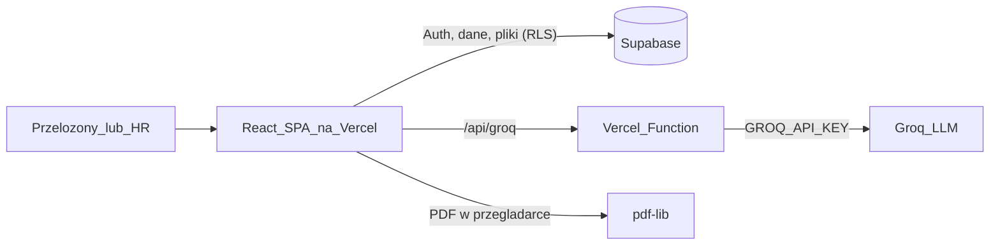
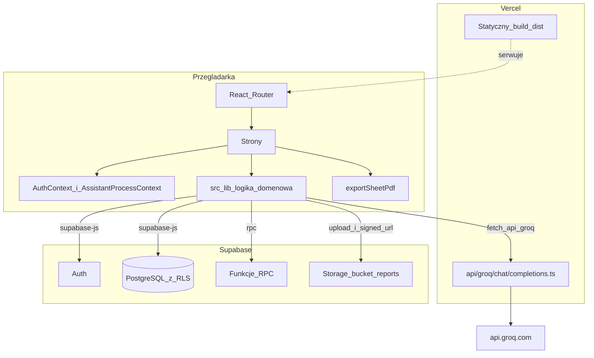
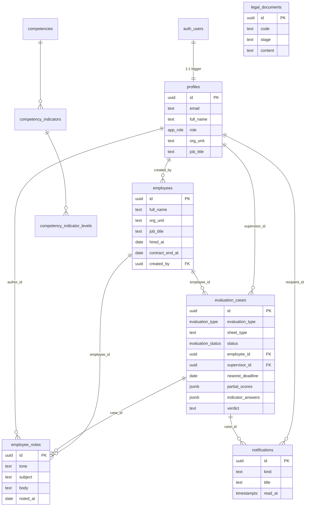
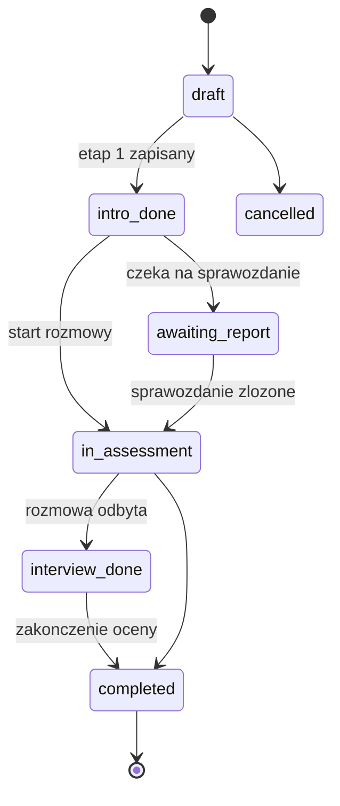
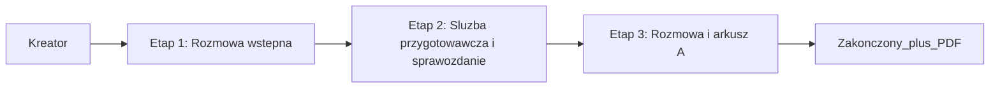
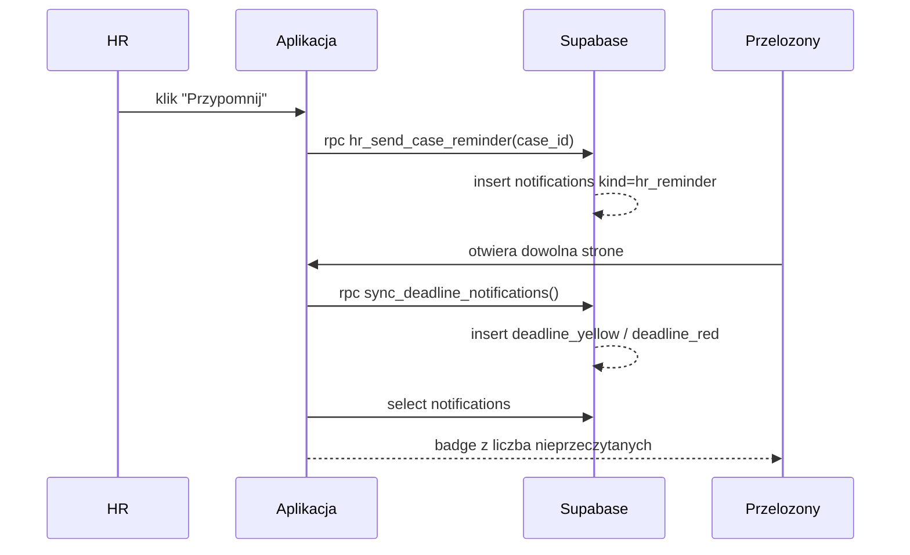

# Kompas Kompetencji

Aplikacja webowa wspierająca przełożonych w służbie cywilnej przy **pierwszej ocenie** i **ocenie okresowej** pracownika (Ministerstwo Cyfryzacji, HackNation). Prowadzi przez cały proces krok po kroku, pilnuje terminów, generuje wypełniony arkusz PDF i podpowiada z pomocą AI na podstawie faktów (uwagi, sprawozdanie, opis stanowiska).

**Przykładowe sprawozdanie pracownika do pobrania:** [`przyklady/sprawozdanie_przyklad.pdf`](przyklady/sprawozdanie_przyklad.pdf) — można je wgrać w procesie (etap 2 → sekcja „Sprawozdanie”).

---

# Część 1 — w skrócie

## Co robi aplikacja

- **Przełożony** zakłada proces dla pracownika, przechodzi 3 etapy (rozmowa wstępna lub kryteria → okres → rozmowa i arkusz), wystawia oceny i werdykt, pobiera PDF.
- **HR** widzi wszystkie procesy i terminy, eksportuje listę do CSV i wysyła przełożonym przypomnienia (dzwonek w aplikacji). Nie prowadzi oceny.
- **Asystent AI** odpowiada na pytania o przepisy i proces, zna etap otwartego procesu i podpowiada plusy/minusy, pytania do rozmowy, kryteria dodatkowe i wnioski rozwojowe.
- **Pracownik nie ma konta** — jest rekordem w bazie, który przełożony dodaje i ocenia.

## Stack

| Warstwa | Technologia |
|---|---|
| Frontend | React 19, TypeScript, Vite, React Router |
| Backend i baza | Supabase: Auth, PostgreSQL z RLS, Storage, funkcje RPC |
| AI | Groq (`openai/gpt-oss-120b`, fallback `gpt-oss-20b`) przez proxy |
| PDF | pdf-lib + fontkit (wypełnianie oficjalnych arkuszy A/B/C) |
| Hosting | Vercel (statyczny SPA + funkcja serverless `/api/groq`) |

## Architektura w jednym obrazku



## Szybki start

```bash
cd "Kompas Kompetencji"
npm install
cp .env.example .env      # uzupełnij klucze Supabase i GROQ_API_KEY
npm run dev               # http://localhost:5173
```

Baza: w Supabase → SQL Editor uruchom po kolei pliki `supabase/setup/01–04` (opis w sekcji [Migracje](#migracje)).

Konta demo (tylko środowisko testowe): przełożony `marek@example.com`, HR `hr@example.com`.

## Bezpieczeństwo

Dostęp do danych pilnuje baza (RLS): przełożony widzi tylko swoich pracowników, sprawy i pliki sprawozdań, HR widzi wszystko. Rolę konta może zmienić tylko HR. Proxy `/api/groq` przyjmuje wyłącznie zalogowanych użytkowników i ma limity rozmiaru zapytania i odpowiedzi. Przed produkcją: wyłączyć publiczną rejestrację w Supabase i zmienić hasła kont demo.

---

# Część 2 — dokumentacja techniczna

## Spis treści

1. [Model domenowy i role](#1-model-domenowy-i-role)
2. [Architektura systemu](#2-architektura-systemu)
3. [Struktura repozytorium](#3-struktura-repozytorium)
4. [Baza danych](#4-baza-danych)
5. [Proces oceny i reguły biznesowe](#5-proces-oceny-i-reguły-biznesowe)
6. [Moduły AI](#6-moduły-ai)
7. [Powiadomienia](#7-powiadomienia)
8. [Generowanie PDF](#8-generowanie-pdf)
9. [Konfiguracja, uruchomienie, wdrożenie](#9-konfiguracja-uruchomienie-wdrożenie)
10. [Mocne strony](#10-mocne-strony)

---

## 1. Model domenowy i role

### Role kont (`profiles.role`)

| Rola | Kto | Uprawnienia w aplikacji |
|---|---|---|
| `supervisor` | Przełożony | Tworzy pracowników i procesy, prowadzi ocenę, dodaje uwagi, wgrywa sprawozdania |
| `unit_head` | Kierujący komórką | Jak przełożony (`canRunEvaluation`) |
| `hr` | HR / administrator | Podgląd wszystkich procesów, eksport CSV, przypomnienia. Formularze oceny zablokowane w UI |
| `employee` | — | Wartość historyczna w enumie, nieużywana |

Funkcje pomocnicze w [`src/types.ts`](src/types.ts): `isStaffRole`, `isHrRole`, `canRunEvaluation`.

### Pojęcia

- **Pracownik** (`employees`) — osoba oceniana, bez konta. Należy do przełożonego, który ją utworzył (`created_by`).
- **Proces / sprawa** (`evaluation_cases`) — jedna ocena jednego pracownika. Typ `first` (pierwsza) albo `periodic` (okresowa, arkusz B lub C).
- **Uwaga** (`employee_notes`) — pozytywna lub negatywna obserwacja z datą i tematem; główne źródło faktów dla AI.
- **Model kompetencji** (`competencies` → `competency_indicators` → `competency_indicator_levels`) — kompetencje, ich wskaźniki („małe pytania” arkusza) i poziomy punktowe.
- **OSP** — opis stanowiska pracy. Trzy przykładowe OSP z paczki MC są w `public/osp` i w [`src/lib/ospPositions.ts`](src/lib/ospPositions.ts).

---

## 2. Architektura systemu

### Komponenty



### Przepływ danych — typowe żądanie

1. Logowanie: `supabase.auth.signInWithPassword` → JWT w przeglądarce → `AuthContext` pobiera wiersz z `profiles`.
2. Odczyt i zapis: komponenty wołają Supabase bezpośrednio (`supabase.from(...)`). Kontrola dostępu jest **wyłącznie w RLS** po stronie bazy; UI tylko ukrywa przyciski.
3. Pliki: upload do bucketu `reports`, odczyt przez podpisany URL ważny 1 h ([`src/lib/reportFile.ts`](src/lib/reportFile.ts)).
4. AI: przeglądarka wysyła prompt na `/api/groq/chat/completions`. Lokalnie przekierowuje to proxy Vite ([`vite.config.ts`](vite.config.ts)), na produkcji funkcja Vercel ([`api/groq/chat/completions.ts`](api/groq/chat/completions.ts)), która sprawdza token zalogowanego użytkownika (dołączany przez `groqHeaders()`) i dokłada `GROQ_API_KEY`. Klucz nigdy nie trafia do przeglądarki.
5. PDF: generowany w całości w przeglądarce z szablonów `public/templates/arkusz{A,B,C}.pdf`.

### Routing ([`src/App.tsx`](src/App.tsx))

| Ścieżka | Strona | Uwagi |
|---|---|---|
| `/` | `HomePage` | przekierowanie na `/dashboard` lub `/login` |
| `/login` | `LoginPage` | e-mail + hasło |
| `/dashboard` | `ProcessListPage` | lista procesów, filtry, CSV, „Przypomnij” (HR), „Usuń” (własne procesy przełożonego) |
| `/procesy/nowy` | `NewProcessWizardPage` | kreator procesu (niedostępny dla HR) |
| `/procesy/:id` | `ProcessDetailPage` | karta procesu z 3 etapami |
| `/prywatnosc` | `LegalInfoPage` | informacje prawne |

Wszystkie strony poza logowaniem są opakowane w `AppShell` (topbar, dzwonek, stopka, pływający asystent AI).

### Stan globalny

- [`AuthContext`](src/auth/AuthContext.tsx) — sesja, profil, `signIn` / `signOut`. Callback `onAuthStateChange` używa `setTimeout`, żeby uniknąć znanego zakleszczenia supabase-js.
- [`AssistantProcessContext`](src/auth/AssistantProcessContext.tsx) — `ProcessDetailPage` publikuje tu zanonimizowany kontekst otwartego procesu (etap, terminy, czy jest sprawozdanie, liczba uwag), z którego korzysta asystent.

---

## 3. Struktura repozytorium

```
Kompas Kompetencji/
├─ api/groq/chat/completions.ts   Funkcja Vercel — proxy do Groq
├─ public/
│  ├─ osp/                        3 przykładowe OSP (PDF + TXT) + catalog.json
│  ├─ templates/arkusz{A,B,C}.pdf Oficjalne arkusze do wypełniania
│  ├─ fonts/arial.ttf             Font z polskimi znakami do PDF
│  └─ sprawozdania/               Przykładowe sprawozdania (generowane skryptem)
├─ scripts/
│  ├─ export_competency_seed.py   Generator seeda modelu kompetencji
│  └─ generate_osp_reports.mjs    Generator przykładowych PDF sprawozdań
├─ src/
│  ├─ App.tsx, main.tsx           Routing i bootstrap
│  ├─ types.ts                    Typy domenowe, etykiety, uprawnienia
│  ├─ auth/                       AuthContext, AssistantProcessContext
│  ├─ components/                 AppShell, AssistantChatbot, NotificationBell, SiteFooter
│  ├─ pages/                      Strony (patrz routing)
│  ├─ lib/                        Logika domenowa, AI, PDF, Supabase
│  └─ index.css                   Cały arkusz stylów (bez frameworka CSS)
├─ supabase/setup/                SQL do uruchomienia w SQL Editor (01–04)
├─ supabase/archive/              Dawne migracje (historia)
├─ vercel.json                    Build + rewrite SPA (z wyłączeniem /api)
└─ vite.config.ts                 Proxy /api/groq w trybie dev
```

### Moduły `src/lib`

| Plik | Odpowiedzialność |
|---|---|
| `supabase.ts` | Klient Supabase z `VITE_SUPABASE_URL` / `VITE_SUPABASE_ANON_KEY` |
| `stages.ts` | 3 etapy UI, mapowanie statusu na etap, checklista rozmowy wstępnej, `nearestDeadlineForCase` |
| `firstEvaluation.ts` | Kwalifikacja do pierwszej oceny, terminy (21 dni, 8 mies.), terminowość zielony/żółty/czerwony |
| `periodicEvaluation.ts` | Arkusze B/C, kryteria obowiązkowe, cykl 24 mies., poziom ogólny ze średniej |
| `competencyModel.ts` | Dobór kompetencji do procesu, średnie wskaźników → ocena cząstkowa, kolory ocen |
| `ospPositions.ts` | Katalog OSP i dopasowanie po stanowisku i komórce |
| `reportFile.ts` | Walidacja i upload pliku sprawozdania, podpisane URL |
| `exportSheetPdf.ts` | Wypełnianie arkusza PDF |
| `notifications.ts` | Odczyt powiadomień, oznaczanie jako przeczytane, RPC przypomnień |
| `groqClient.ts` | Wspólny klient Groq z łańcuchem modeli i fallbackiem |
| `groqSuggest*.ts` | Cztery funkcje AI: kryteria, pytania, dowody (plusy/minusy), wnioski rozwojowe |
| `parseModelJson.ts` | Odporne parsowanie JSON z odpowiedzi modelu |
| `assistantChat.ts` | Logika czatu: odpowiedzi lokalne bez tokenów + wywołanie modelu |
| `legalKnowledge.ts` | Pobieranie i ranking dokumentów prawnych z `legal_documents` (z cache 5 min i fallbackiem) |
| `processAssistantHints.ts` | Kontekst procesu, „co teraz zrobić”, słownik ekranu dla asystenta |
| `formatOrgUnit.ts` | Skracanie nazw komórek organizacyjnych |

---

## 4. Baza danych

### Diagram ER



### Tabele

| Tabela | Opis | Kluczowe kolumny |
|---|---|---|
| `profiles` | Konta logujące się (1:1 z `auth.users`, tworzone triggerem `handle_new_user`) | `role`, `org_unit`, `job_title`, `is_unit_head` |
| `employees` | Pracownicy oceniani | `first_name`, `last_name`, `hired_at`, `contract_end_at`, `created_by` |
| `evaluation_cases` | Proces oceny — wszystkie dane etapów w jednym wierszu | patrz niżej |
| `employee_notes` | Uwagi o pracowniku | `tone` (positive/negative), `subject`, `body`, `noted_at`, `case_id` |
| `competencies`, `competency_indicators`, `competency_indicator_levels` | Model kompetencji (seed ~118 KB) | `code`, `for_first_evaluation`, `points` |
| `legal_documents` | Baza wiedzy dla asystenta (rozporządzenia, poradniki) | `code`, `stage`, `content`, `sort_order` |
| `notifications` | Powiadomienia w aplikacji | `recipient_id`, `case_id`, `kind`, `read_at` |

Kolumny `evaluation_cases` pogrupowane według etapu:

- **Identyfikacja:** `evaluation_type`, `sheet_type` (`first` / `B` / `C`), `status`, `employee_id`, `supervisor_id`, `unit_head_id`, `year`, `progress_percent`.
- **Kwalifikacja (pierwsza ocena):** `eligibility_result`, `first_time_civil_service`, `is_substitute`, `is_ksap_graduate`, `is_higher_position`, `prep_service_status`, `exam_required`, `exam_result`.
- **Etap 1:** `intro_talk_at`, `intro_talk_deadline`, `intro_checklist` (jsonb); dla okresowej `criteria_talk_at`, `extra_criteria` (jsonb, max 3).
- **Etap 2:** `report_due_from`, `report_due_to`, `report_submitted_at`, `report_on_time`, `report_notes`, `report_file_*`, `prep_service_end_at`, `assessment_interview_at`.
- **Etap 3:** `interview_notes`, `indicator_answers` (jsonb), `partial_scores` (jsonb), `verdict`, `verdict_justification`, `development_notes`.
- **Terminy:** `assessment_window_from/to`, `nearest_deadline`, `cycle_anchor_at`, `cycle_due_at`, `next_cycle_due_at`.

### Statusy procesu



Mapowanie na etapy UI: `draft` → 1; `intro_done`, `awaiting_report` → 2; `in_assessment`, `interview_done`, `completed` → 3 ([`stages.ts`](src/lib/stages.ts)).

### Polityki RLS (stan obecny)

| Tabela | SELECT | INSERT | UPDATE | DELETE |
|---|---|---|---|---|
| `profiles` | własny lub HR | trigger (rola zawsze `supervisor`) | własny lub HR; zmiana `role` / `is_unit_head` tylko przez HR (trigger) | — |
| `employees` | `created_by` lub HR | `created_by` = ja i rola staff | `created_by` lub HR | `created_by` lub HR |
| `evaluation_cases` | HR, `supervisor_id`, `unit_head_id` | staff, `supervisor_id` = ja (HR dowolnie) | HR lub `supervisor_id` | `supervisor_id` = ja (przełożony / kierujący, bez HR) |
| `employee_notes` | HR lub właściciel pracownika | autor = ja i (HR lub właściciel) | — | — |
| `competencies*` | zalogowani | — | — | — |
| `legal_documents` | staff | — | — | — |
| `notifications` | odbiorca lub HR | tylko RPC | odbiorca | — |
| `storage: reports` (ścieżka `case_id/plik`) | przełożony sprawy, kierujący, HR | przełożony sprawy | przełożony sprawy | przełożony sprawy |

Funkcja `public.current_role()` (security definer) zwraca rolę bieżącego użytkownika i jest używana w większości polityk.

### Funkcje RPC

| Funkcja | Kto | Co robi |
|---|---|---|
| `current_role()` | wszyscy | rola z `profiles` dla `auth.uid()` |
| `hr_send_case_reminder(case_id)` | tylko HR | tworzy powiadomienie `hr_reminder` dla przełożonego sprawy |
| `sync_deadline_notifications()` | przełożony | tworzy powiadomienia `deadline_yellow` / `deadline_red` dla jego spraw |

### Migracje

Cała baza jest opisana w czterech plikach w `supabase/setup/`. Uruchamia się je ręcznie w Supabase → SQL Editor, w tej kolejności:

| Plik | Co robi | Można powtarzać? |
|---|---|---|
| `01_schema.sql` | Typy, tabele, kolumny, indeksy, funkcje, triggery, RLS, uprawnienia, bucket `reports` z politykami | Tak — nic nie kasuje, dokłada brakujące elementy i nadpisuje polityki/funkcje |
| `02_seed_competencies.sql` | Model kompetencji (kompetencje, wskaźniki, poziomy) | Tak — wstawia dane tylko, gdy tabela `competencies` jest pusta |
| `03_seed_legal_knowledge.sql` | Baza wiedzy asystenta (rozporządzenia, poradniki) | Tak — upsert po `code` |
| `04_seed_demo.sql` | Opcjonalnie: role kont demo i 4 przykładowe procesy z uwagami | Tak, ale **usuwa i odtwarza** pracowników i sprawy konta `marek@example.com` |

Ten sam zestaw działa na pustym projekcie i na bazie zbudowanej wcześniej starymi migracjami. Starsza baza z `employee_id` wskazującym na `profiles` jest przepinana na `employees` bez kasowania danych.

Konta demo (`marek@example.com`, `hr@example.com`, hasło `Test1234!`) zakłada się w Supabase → Authentication → Users przed uruchomieniem `04_seed_demo.sql`.

Dawne migracje (`0xx_*`, `FIX_*`, `SEED_*`) są w `supabase/archive/migrations/` jako historia — nie trzeba ich uruchamiać.

---

## 5. Proces oceny i reguły biznesowe

### Pierwsza ocena (Dz. U. 2015 poz. 1144)



- **Kreator:** dane pracownika, ścieżka kwalifikacji (pierwsze zatrudnienie, zastępstwo, KSAP, wyższe stanowisko), wymóg służby przygotowawczej i egzaminu, obsada ról, wyliczenie terminów.
- **Terminy** (`computeDeadlines`): rozmowa wstępna do 21 dni od zatrudnienia; sprawozdanie od 8 mies. (+30 dni okna); ocena najpóźniej miesiąc przed końcem umowy lub 11 mies. od zatrudnienia.
- **Etap 1:** checklista 5 punktów (procedura, elementy oceny, oczekiwania, OSP, termin sprawozdania) + data rozmowy. AI może zaproponować pytania.
- **Etap 2:** wynik egzaminu, plik sprawozdania (PDF/DOC/DOCX/obraz, max 10 MB), data złożenia i terminowość, notatka, data rozmowy oceniającej.
- **Etap 3:** 5 kompetencji, każda oceniana przez wskaźniki; średnia wskaźników podpowiada ocenę cząstkową 3/5/7 (można ją ręcznie nadpisać). Werdykt: pozytywny wymaga m.in. średniej ≥ 5 i najwyżej jednej oceny 3. Przy negatywnym uzasadnienie jest obowiązkowe.

### Ocena okresowa (Dz. U. 2016 poz. 470)

- **Arkusz B** — stanowiska z kierowaniem ludźmi; obowiązkowe: zarządzanie ludźmi, podejmowanie decyzji, organizacja, współpraca, komunikacja.
- **Arkusz C** — pozostałe; obowiązkowe: wiedza, rzetelność, organizacja, współpraca, komunikacja.
- Do 3 kryteriów dodatkowych z OSP (AI może je zaproponować).
- Cykl: termin sporządzenia = kotwica + 24 mies.; rozmowa o kryteriach do 30 dni.
- Skala 1/3/5/7/9; poziom ogólny ze średniej (`overallLevelFromAverage`). Pozytywna przy poziomie co najmniej „na poziomie oczekiwań” i braku oceny cząstkowej 1.

### Terminowość na liście

`timelinessForDeadline`: czerwony — po terminie; żółty — 14 dni lub mniej; zielony — więcej; brak oznaczenia dla spraw zakończonych i anulowanych.

---

## 6. Moduły AI

Wszystkie wywołania idą przez [`groqClient.ts`](src/lib/groqClient.ts): próbuje kolejno `VITE_GROQ_MODEL`, `gpt-oss-120b`, `gpt-oss-20b`; przy błędzie HTTP lub pustej odpowiedzi przechodzi do następnego modelu. Dla modeli `gpt-oss` ustawia `reasoning_effort: low`.

| Funkcja | Gdzie w UI | Wejście | Wyjście | Limity |
|---|---|---|---|---|
| `suggestIntroQuestions` | Etap 1 | OSP, stanowisko | max 3 pytania + źródła | OSP ≤ 4000 znaków |
| `suggestExtraCriteria` | Etap 1 (okresowa) | OSP, arkusz | max 3 kody kompetencji | OSP ≤ 6000 znaków |
| `suggestEvidenceFromFacts` | Etap 3 | uwagi, opis sprawozdania, notatki z rozmowy, model kompetencji | plus/minus/brak danych per kompetencja i wskaźnik; podsumowanie max 3+3 | max 12 uwag po 420 znaków, faktów ≤ 4500 znaków |
| `suggestDevelopmentActions` | Etap 3, pod uzasadnieniem | słabsze kompetencje, uzasadnienie, skrót uwag | max 3 obszary do pracy | uzasadnienie ≤ 1200, uwagi ≤ 1500 znaków |
| `askAssistant` | Pływający czat | pytanie, historia, kontekst procesu, baza prawna | odpowiedź w Markdown | historia 3 wiadomości po 500 znaków, odpowiedź ≤ 420 tokenów |

Zasady wspólne:

- AI **nie wystawia ocen** ani werdyktu — tylko podpowiada, przełożony zatwierdza.
- Fakty wyłącznie ze źródeł; przy braku danych model ma odpowiedzieć „brak istotnych informacji”.
- **Treść pliku PDF sprawozdania nie jest czytana** — AI widzi tylko pole „Notatka / opis sprawozdania”.
- Asystent czatu nie dostaje imienia i nazwiska pracownika ani stanowiska przełożonego.
- Część odpowiedzi jest lokalna, bez wywołania API: „Co mam teraz zrobić?”, „gdzie wgrać sprawozdanie”, „jak przeprowadzić pierwszą ocenę”.
- Baza prawna: `legal_documents` jest rankowana pod treść pytania (max 3 dokumenty, ≤ 5500 znaków); gdy tabela jest niedostępna, używany jest skrót awaryjny `LEGAL_FALLBACK`.

---

## 7. Powiadomienia

Dzwonek w topbarze ([`NotificationBell.tsx`](src/components/NotificationBell.tsx)) odświeża się przy wejściu na stronę, co 60 s i przy otwarciu panelu.



- Powiadomienia o terminach tworzą się „leniwie” przy aktywności przełożonego — nie ma crona.
- Antyspam: jedno nieprzeczytane powiadomienie danego rodzaju na sprawę; po przeczytaniu kolejne najwcześniej po 3 dniach.
- Ręczne przypomnienie HR zastępuje poprzednie nieprzeczytane przypomnienie dla tej sprawy.

---

## 8. Generowanie PDF

[`exportSheetPdf.ts`](src/lib/exportSheetPdf.ts) ładuje szablon `arkuszA.pdf` (pierwsza ocena) albo `arkuszB.pdf` / `arkuszC.pdf`, osadza `arial.ttf` (polskie znaki) i nanosi tekst w stałych współrzędnych: dane pracownika i przełożonego, oceny cząstkowe, średnią, werdykt, uzasadnienie. Całość dzieje się w przeglądarce — dane nie opuszczają urządzenia.

---

## 9. Konfiguracja, uruchomienie, wdrożenie

### Zmienne środowiskowe

| Zmienna | Gdzie | Opis |
|---|---|---|
| `VITE_SUPABASE_URL` | frontend | URL projektu Supabase |
| `VITE_SUPABASE_ANON_KEY` | frontend | klucz publiczny (bezpieczny tylko przy poprawnym RLS) |
| `VITE_GROQ_MODEL` | frontend | preferowany model (domyślnie `openai/gpt-oss-120b`) |
| `GROQ_API_KEY` | **tylko serwer** | klucz Groq; proxy Vite lokalnie, funkcja Vercel na produkcji. Nie dodawać prefiksu `VITE_` |

Funkcja `/api/groq` na Vercel używa też `VITE_SUPABASE_URL` i `VITE_SUPABASE_ANON_KEY` do sprawdzenia, czy żądanie pochodzi od zalogowanego użytkownika — bez nich AI na produkcji zwraca 401. Lokalne proxy Vite tokenu nie sprawdza.

### Skrypty

| Komenda | Działanie |
|---|---|
| `npm run dev` | serwer deweloperski z proxy `/api/groq` |
| `npm run build` | `tsc -b` + `vite build` do `dist/` |
| `npm run preview` | podgląd buildu |
| `npm run lint` | oxlint |
| `node scripts/generate_osp_reports.mjs` | przykładowe sprawozdania PDF do `public/sprawozdania/` |

### Wdrożenie na Vercel

1. Import repozytorium, framework **Vite** (konfiguracja w [`vercel.json`](vercel.json)).
2. Environment Variables: cztery zmienne z tabeli wyżej, `GROQ_API_KEY` jako Secret dla Production i Preview.
3. Redeploy po zmianie zmiennych.
4. W Supabase → Authentication → URL Configuration dodaj adres produkcyjny do Site URL i Redirect URLs.

`vercel.json` przepisuje wszystkie ścieżki poza `/api/*` na `index.html` (routing SPA).

---

## 10. Mocne strony

- Klucz Groq tylko po stronie serwera; fallback modeli i twarde limity tokenów.
- Kontrola dostępu do danych oparta o RLS, a nie tylko o UI.
- Logika domenowa wydzielona do czystych funkcji w `src/lib` (łatwa do przetestowania).
- AI ograniczone do faktów ze źródeł, z anonimizacją i odpowiedziami lokalnymi bez kosztu tokenów.
- Generowanie PDF w przeglądarce na oficjalnych szablonach.
